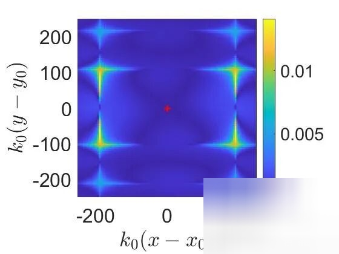
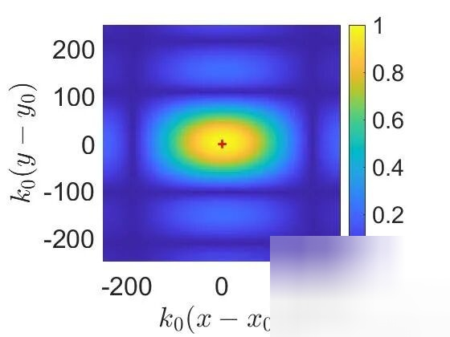
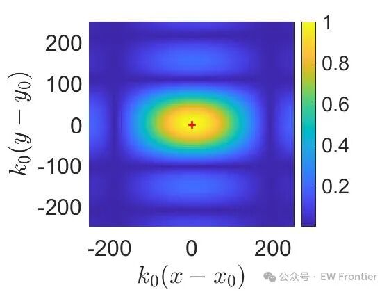

# [SAR Imaging] SAR Imaging and RCS Recovery of Limited-Size Targets in Free Space with MATLAB Code

Currently, the manuscript may not have been accepted yet, and it is currently unverifiable online. Only the corresponding code exists~  
SAR imaging and RCS recovery of finite-sized targets in free space. DOI: 10.5281/zenodo.15368352  
This Matlab code collection is used to calculate the simulation results included in the manuscript "Detecting, locating and spectrally characterizing targets with SAR" by A.D. Kim, J. Simpson, and C. Tsogga.  
The code "point_target_asymptotic_image.m" simulates SAR data for point targets and calculates the corresponding KM images. It also generates asymptotic KM images and calculates the absolute difference between the true and asymptotic KM images. These figures correspond to Figure 2 in the manuscript.  
The code "asymptotic_KM_images.m" uses "SAR_data_MFS_3D.m" and "sphere3D.m" to simulate SAR data for dielectric spheres and calculate the corresponding KM images. It also generates asymptotic KM images and calculates the absolute difference between the true and asymptotic KM images. These figures correspond to Figures 3 and 4 in the manuscript.  
The code "single_ellipsoid_image.m" uses "SAR_data_MFS_3D.m" and "ellipsoid3D_equal.m" to simulate SAR data for an electrically-dielectric ellipsoid and calculate the corresponding KM image. It also uses "backscatamp3D_mfs.m" to calculate the scattering amplitude in the backscatter direction for the ellipsoid. These figures correspond to Figure 5 in the manuscript.
The code "two_sphere_images_linearity.m" simulates the SAR data of two dielectric spheres using "SAR_data_MFS_3D.m", "twospheres.m", and calculates the corresponding KM images. It also generates modified KM images using the approximate linearity of the KM imaging function. These figures correspond to Figure 6 in the manuscript.
The code "single_RCS_recovery.m" simulates the SAR data of dielectric spheres and ellipsoids using "SAR_data_MFS_3D.m", "sphere3D.m", and "ellipsoid3D_equal.m", and calculates the corresponding KM images. It also recovers the RCS spectrum of each target. These figures correspond to Figure 7 in the manuscript.
The code "two_sphere_rcs_bp.m" simulates the SAR data of two dielectric spheres using "SAR_data_MFS_3D.m" and "twospheres.m", and calculates the corresponding KM and modified KM images to locate targets. Then, these target positions are used together with the array backpropagation method to restore the RCS spectra of the two spheres. These figures correspond to Figure 8 in the manuscript.
The code "two_sphere_rcs_int.m" simulates the SAR data of two dielectric spheres using "SAR_data_MFS_3D.m" and "twospheres.m", and calculates the corresponding KM and modified KM images to locate targets. Then, these target positions are used together with interpolation methods to restore the RCS spectra of the two spheres. These figures correspond to Figure 9 in the manuscript.
MATLAB simulation results

## Images

<!-- PAYMENT_BLOCK -->

## Get this dataset

- Payment link (Stripe): [Buy now](https://buy.stripe.com/3cs8yP7sY87d0vu9AB)
- Payment QR code: 

<!-- /PAYMENT_BLOCK -->
